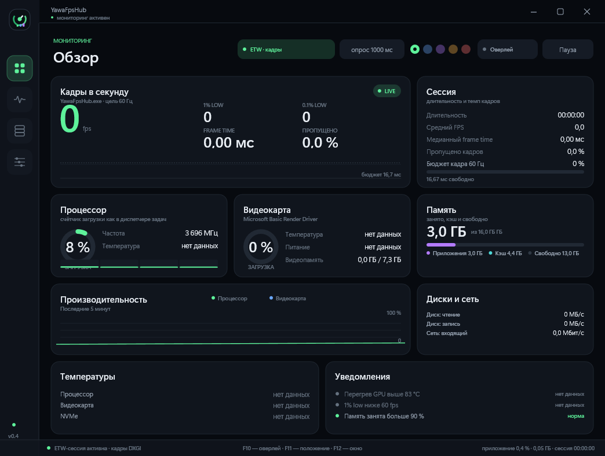
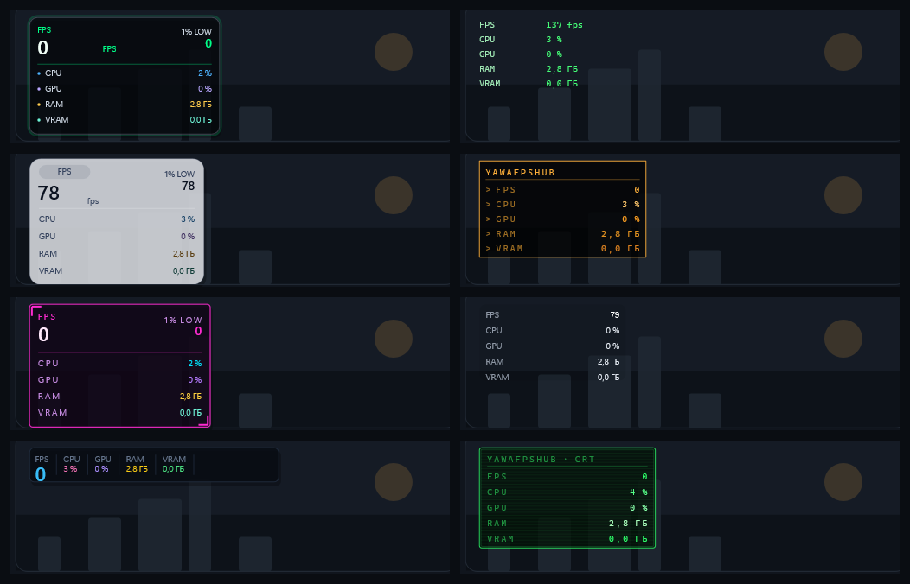

# YawaFpsHub

Монитор FPS и состояния системы для Windows. Один распространяемый exe, без сети
и DLL-инъекций. Основные показатели работают на API Windows; для аппаратных CPU-датчиков
приложение само предлагает стандартное подтверждение UAC и готовит встроенный подписанный PawnIO.
Для расширенных GPU-датчиков используются библиотеки уже установленного видеодрайвера.
О локальных файлах, отсутствии автоматической отправки данных и порядке сообщения
об уязвимостях: [Приватность](PRIVACY.md) · [Безопасность](SECURITY.md).



Краткие объяснения FPS, 1 % low, ETW, UMC и XMP/EXPO — в [словаре показателей](docs/glossary.md).

## Кадры, как в RTSS

Средний FPS, 1 % low, 0,1 % low, frame time и доля пропущенных кадров. Игра определяется по
активному окну, счёт кадров идёт по системным событиям DirectX — в процесс игры ничего не
внедряется, поэтому мониторинг не конфликтует с античитами и не ломает игру. Значения
обновляются с той же периодичностью, что диспетчер задач, и их можно замедлить или ускорить.

## Оверлей поверх игры

Отдельное окно: не перехватывает клики, не трогает кадры игры и не мешает оверлеям самих игр.

- 16 рецептов оформления, включая восемь прежних стилей: форму (плитка/строка/шкала),
  поверхность и шрифт можно менять независимо. Старые INI сохраняют прежний вид;
  описание рецепта экспортируется и импортируется локально через JSON `schema: 1`
  (Win32-импорт пока не проверен на Windows);
- перетаскивание обычной мышью прямо по тексту, четыре позиции и сквозной режим кликов;
- редактор текста: семейство, кегль, начертание, обводка, фон, рамка, тень, скругление,
  отступы, межстрочный интервал, разрядка, регистр, число знаков после запятой у кадров
  и цвет каждой строки отдельно;
- подписи датчиков можно переименовать или стереть — кириллица работает;
- один редактор с разделами «Собрать», «Оформить», «Текст», «Строки»: рецепт,
  раскладка, масштаб и прозрачность рядом с холстом; полные параметры доступны
  по теме, без отдельного режима и длинного списка переключателей;
- опциональный график последних 32 измерений FPS в оверлее и предпросмотре
  (включается в разделе «Собрать»; без достоверной истории не рисуется);
- вся настройка оверлея собрана в редакторе: стили, вид, типографика, подписи, цвета,
  состав строк через поиск «+ Датчик», порядок перетаскиванием и координаты. Глазик
  в списке датчиков тоже переключает соответствующую строку, остальные не затрагивает;
- редактор показывает живой предпросмотр на холсте; подписи и значения каждой строки
  можно двигать независимо с шагом 1 px (Shift + стрелка — 10 px, Tab — выбор части).
  Ctrl + клик выделяет несколько строк; Shift при перетаскивании включает сетку 8 px.
  Инспектор позволяет менять текст, координаты и цвет выбранного значения прямо там же.
  «Вернуть шаблон» восстанавливает автоматическую раскладку. Необязательный переключатель
  «На мониторе игры» временно переносит отрисовку на экран активной игры, сохраняя
  прежнюю позицию для выхода из игры. По умолчанию выключен. При новом перемещении
  свободной плашки запоминаются монитор и координаты внутри него; старые INI
  используют прежние виртуальные координаты.
  Файлы шаблонов RTSS не импортируются.



## Датчики

- **Процессор**: общая загрузка, самое занятое ядро, загрузка каждого ядра, температура,
  частота, питание и поток игры.
- **Видеокарта**: загрузка, температура и hot-spot, частоты ядра и памяти, питание, обороты
  вентилятора, занято и всего видеопамяти, кодирование и декодирование видео, нагрузка шины
  PCI-e.
- **Память**: занято, в кэше, свободно, загрузка ОЗУ, файл подкачки — занято, всего и его
  загрузка.
- **Накопители и сеть**: чтение, запись, температура NVMe, входящий и исходящий трафик.
- **Служебные**: собственное потребление мониторинга, число потоков, температура чипсета.

Всё это — 56 показателей с историей, статистикой за сессию, поиском и фильтром по группам.
Там, где система не отдаёт данные, показывается «нет данных», а не ноль; подтверждённые
причины отсутствия аппаратных CPU-датчиков выводятся отдельно. Результаты реальных
проверок и добровольные отчёты — в [матрице железа](docs/hardware-matrix.md).

## Баланс системы

Экран сопоставляет замеры активной игры с паспортом системы. Игра определяется по
активному окну и кадрам ETW; загрузка CPU берётся по времени **её процесса**, GPU — из
PDH для её PID и 3D-движка выбранной видеокарты. Общая загрузка системы показана
отдельно и не участвует в вердикте. При малой нагрузке, отсутствии игры или недоступном
счётчике вывод об узком месте не делается. Частота монитора на вердикт не влияет;
сравнение нагрузок не является измерением потенциального прироста FPS.
Кнопка «Создать снимок…» показывает отдельную PNG-карточку 1920×1080 перед локальным
сохранением PNG или `.yawa`. По умолчанию кадр игры не захватывается: отчёт содержит
лишь доступные показатели и честное «нет данных». В предпросмотре можно отдельно
включить захват кадра выбранной игры: после пяти секунд на переключение в игру
кадр вернётся в карточку. Перед сохранением проверьте посторонние окна, закройте
личное прямоугольными масками или уберите кадр. `screen.png` в `.yawa` совпадает
с итоговым предпросмотром; сырой кадр отдельно не сохраняется. Работу этой функции
на реальной Windows-игре ещё нужно проверить. Для проверки присланного пакета
локально доступна команда `--report=<путь-к-файлу.yawa>`: она печатает статус
схемы, наличие кадра и данные сессии. Флаг `--json` с этой командой выдаёт
машинно-читаемый объект или код ошибки без содержимого пакета. CLI не открывает PNG
и не запускает датчики. На экране «Баланс» кнопка «Открыть .yawa…» показывает
проверенную карточку в отдельном окне без извлечения файлов на диск. Показания и
пиксели из чужого пакета могут быть недостоверными; UX на живой Windows
ещё не проверен. Для пересылки можно отдельно запустить
`--report=<локальный-файл.yawa> --html=<новый-файл.html>`: команда создаёт один
самодостаточный офлайн-HTML со встроенной итоговой PNG-карточкой, сессией и
заявленным диагнозом, без скриптов и сетевых ресурсов. В отчёте явно отмечено,
что паспорт, аудит и история датчиков ещё не собраны, а выводы не сверены с
измерениями. Существующий HTML не перезаписывается; перед отправкой проверьте
содержимое изображения.


## Сведения о системе

Как в панели NVIDIA: модель процессора, ядра, потоки, кэш и базовая частота; все видеокарты с
объёмом памяти и версией драйвера; Windows той же строкой, что показывает `winver`; память по
данным BIOS — «2×16 ГБ DDR5-6000», частота, расчётный такт tCK, напряжение,
производитель и партномер каждой планки и занятые слоты. При неполных сведениях
SMBIOS дополняется `Win32_PhysicalMemory` и `Win32_PhysicalMemoryArray` (WMI);
датчики запускаются после показа окна, а WMI дополняет быстрый паспорт в фоне, чтобы
ожидание провайдера не блокировало интерфейс. Это резервные сведения BIOS, а не независимое измерение. Размеры модулей со спорным суммарным объёмом
не выдаются за проверенные; XMP/EXPO и реальные тайминги
из SMBIOS не определяются.

Действующие тайминги экспериментально читаются из UMC только для AMD Matisse
(17h/71h) или Cezanne (19h/50h, включая Ryzen 7 5800H) с подтверждённым каналом
DDR4 и доступным PawnIO. Показания на 5800H ещё не проверены на физической плате.
Во всех остальных случаях карточка показывает «недоступны».
Офлайн-декодер умеет проверять полный DDR4 SPD и распознавать признак XMP 2.0.
Отдельная явная команда `--probe --spd=50`…`57` читает DDR4 SPD через PawnIO
на Cezanne; работу чтения на Ryzen 7 5800H подтвердил пользователь. При старте
приложения SPD не сканируется, в UI паспорт ещё не подключён. Пробник выводит
партномер из паспорта модуля только при корректном ASCII-поле; поле не покрыто CRC,
на настоящем модуле результат ещё не проверен. Серийный номер не выводится,
а активность XMP из одного SPD не определяется.


## Настройки, которые понятно менять

Интервал опроса, цель кадра (в том числе автоматически по герцовке монитора), сглаживание
графиков, пауза опроса, акцент интерфейса, компактная плотность, поведение при закрытии окна,
горячие клавиши (редактируются в интерфейсе) и выбор видеокарты выпадающим списком.
В карточке «О программе» кнопка «Что нового» открывает встроенный в exe `CHANGELOG.md`
в прокручиваемом окне: файл рядом с приложением и сеть не нужны.

Настройки, лог и записи сессий лежат в `%LOCALAPPDATA%\YawaFpsHub` — файл программы можно
положить в любую папку и запустить оттуда. Само приложение не включает автозапуск;
при согласии с UAC для аппаратных CPU-датчиков регистрируется драйвер PawnIO. Если рядом
с `YawaFpsHub.exe` остался `YawaFpsHub.ini` из старой версии, он
переносится автоматически.

## Горячие клавиши

- `F10` — показать или скрыть оверлей;
- `F11` — следующая позиция оверлея;
- `F12` — свернуть окно в область уведомлений;
- `F9` — сквозной режим кликов для оверлея.

Все четыре настраиваются в разделе «Настройки».

## Экономность

Опрос раз в секунду, в простое без игры замедляется до двух секунд, свёрнутое или скрытое окно
не перерисовывается. На тестовой машине это около 47 МБ памяти и доли процента загрузки ядра.

## Требования

Windows 10 или 11, 64 бита. Видеокарта — NVIDIA, AMD или Intel: загрузка и видеопамять есть на
всех трёх, температуры, частоты и питание — там, где их отдаёт драйвер, нагрузка шины PCI-e —
на NVIDIA. Мониторинг работает и без дискретной графики.

## Релизы

После успешной сборки и тестов каждого push в `main` GitHub Actions создаёт Release
`v<версия>-build.<номер сборки>` с одним файлом `YawaFpsHub.exe`. Обновление номера
версии в `VERSION` остаётся отдельным решением; правила и ручной выпуск описаны в
[документации релизов](docs/releases.md).

## Низкоуровневые датчики CPU (PawnIO)

В Windows-сборку MSVC встроен подписанный AMD64-пакет PawnIO 2.2.0 и аппаратные
модули CPU. Стороннее приложение мониторинга и PawnIOLib не требуются. При обычном запуске приложение может запросить стандартное подтверждение UAC для
аппаратных датчиков. Если драйвер недоступен на поддерживаемом CPU, экран датчиков
предлагает и кнопку «Включить» для повторной попытки. Отсутствие запроса UAC само
по себе не объясняет отсутствие показаний. Приложение проверяет встроенный пакет
и при необходимости устанавливает SYS/INF/CAT через Windows SetupAPI. Запускать PowerShell, вводить команды и скачивать
дополнительные файлы не требуется. Уже установленный совместимый PawnIO используется
без замены. При отказе UAC, ошибке установки или запрете драйвера со стороны Windows
приложение продолжает работать с доступными датчиками, а температура и мощность CPU
показывают «нет данных» — не термозону ACPI.

Windows не позволяет приложению обходить UAC. Устройство PawnIO разрешает доступ
только администраторам, поэтому для доступа к аппаратным CPU-датчикам могут
потребоваться повышенные права; для обычного пользователя Windows может
потребовать учётные данные администратора. Если Windows просит перезагрузку для
завершения установки драйвера, её нужно выполнить. Защита Windows не отключается;
на некоторых системах PawnIO может быть заблокирован политикой безопасности.
Драйвер остаётся зарегистрированным после выхода из приложения и не удаляется
автоматически, поскольку им могут пользоваться другие мониторы.

Первый этап: Intel family 6 — package DTS и мощность RAPL, если эти MSR доступны;
AMD family 17h/19h/1Ah — Tctl через SMN и мощность package из счётчика энергии.
Tctl не равна универсальной Tdie; модельные поправки не выдумываются. Считывается
пакет процессора, содержащий логический процессор 0 группы 0, не сумма всех сокетов.
Мощность появляется после двух успешных чтений. VRM, EC/SMBus и многосокетная
агрегация пока не реализованы; экспериментальные тайминги UMC ограничены Matisse/Cezanne DDR4. GPU и накопители описаны ниже.

Исходники и лицензии поставляемых компонентов встроены в exe. Из каталога, в который
можно записывать файлы, выполните (права администратора для этого не нужны):

```powershell
.\YawaFpsHub.exe --sensor-sources
```

Появится `YawaFpsHub-PawnIO-sources.zip`; существующий файл не перезаписывается.
Состав и происхождение пакета: [third_party/pawnio/README.md](third_party/pawnio/README.md).
Удаление установленного устройства PawnIO выполняется через диспетчер устройств,
с учётом других потребителей драйвера.

Пересчёт показаний покрыт тестами; установка и реальные значения на оборудовании,
в том числе Secure Boot/HVCI, требуют отдельной проверки на Windows. Перекрёстная
сборка сама по себе этой проверки не заменяет.

### Добровольный дамп памяти

Только если требуется проверить экспериментальные тайминги на **AMD Matisse/Cezanne DDR4**,
в PowerShell можно явно запустить диагностическую команду основного exe:

```powershell
Start-Process -FilePath .\YawaFpsHub.exe -ArgumentList '--probe --dump=memory' -Wait -RedirectStandardOutput .\memory.txt
```

Команда не запускает интерфейс и не устанавливает драйвер / не запрашивает UAC. Для
чтения требуется уже доступный PawnIO; если его нет, выводится «unavailable» и
код завершения 1. Читаются только регистры конфигурации и таймингов UMC двух
каналов, SPD и серийные номера не считываются. Приложение ничего не сохраняет и не
отправляет само: файл `memory.txt` создаёт только указанное пользователем
перенаправление вывода. Дамп может раскрывать конфигурацию памяти — проверьте его
перед добровольной публикацией. Работа команды на Windows пока не проверена.

### GPU и накопители

- AMD ADL: PMLog — edge/hotspot, частоты GPU/VRAM, ASIC power, RPM;
  резерв температуры — Overdrive 5. Поддержка отдельных полей зависит от драйвера и GPU.
- Intel Control Library: температура, частоты GPU/VRAM, RPM и мощность по энергии/времени.
  Обычно наиболее полный набор даёт Arc; на iGPU API может не поддерживать эти поля.
- Intel сопоставляется по LUID; AMD — по активному display path/LUID, либо по имени,
  когда AMD-адаптер только один. NVIDIA — по однозначному имени. При неоднозначности
  нет подстановки первой карты и нет показаний от другого вендора.
- Температура диска в оверлее: максимум среди доступных физических дисков, не обязательно системного.
  На экране «Система» NVMe SMART показывается **по каждому физическому диску отдельно** только
  при совпадении номера устройства Windows с WMI Index. Используются read-only
  StorageDeviceProtocolSpecificProperty и NVMe health log: процент использованного ресурса,
  резерв, приближённый объём записанных данных и ошибки носителя. Если драйвер не отдаёт
  журнал или номер нельзя сопоставить, показано «нет данных»; SATA/USB/RAID не подменяются
  SMART соседнего устройства. Опрос в фоне раз в 5 секунд, данные старше 15 секунд скрыты;
  аппаратная сверка на реальном NVMe пока не проводилась.

Заголовки GPU API и их лицензии: `third_party/gpu_sdk`; они также входят в экспорт
`--sensor-sources`. DLL вендоров не встраиваются и ищутся только в доверенных каталогах
Windows/драйвера. Встроенный PawnIO не заменяет установленный драйвер видеокарты.
Управление частотами, вентиляторами, напряжениями и запись SMART не выполняются.
